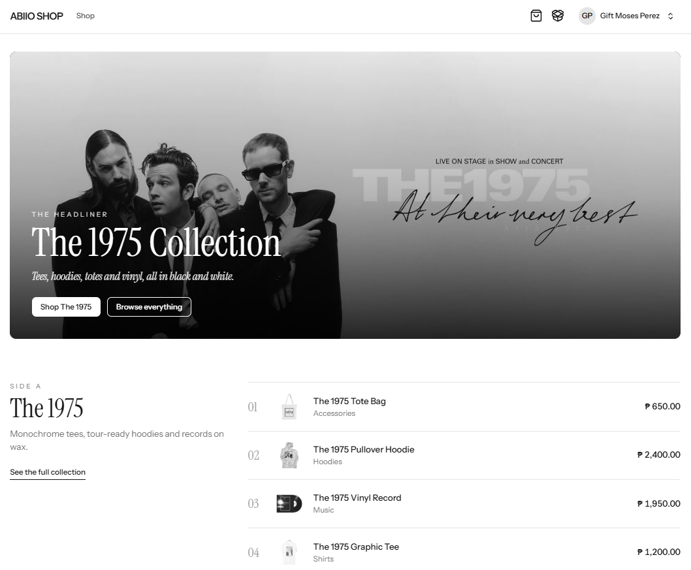
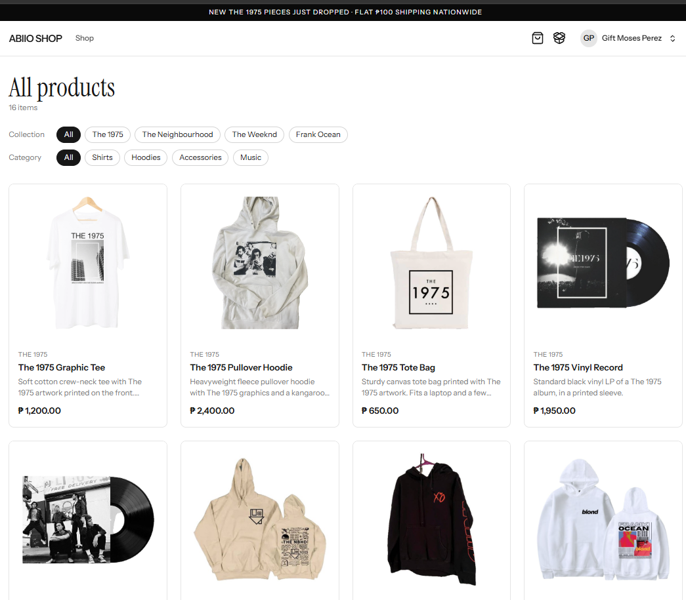
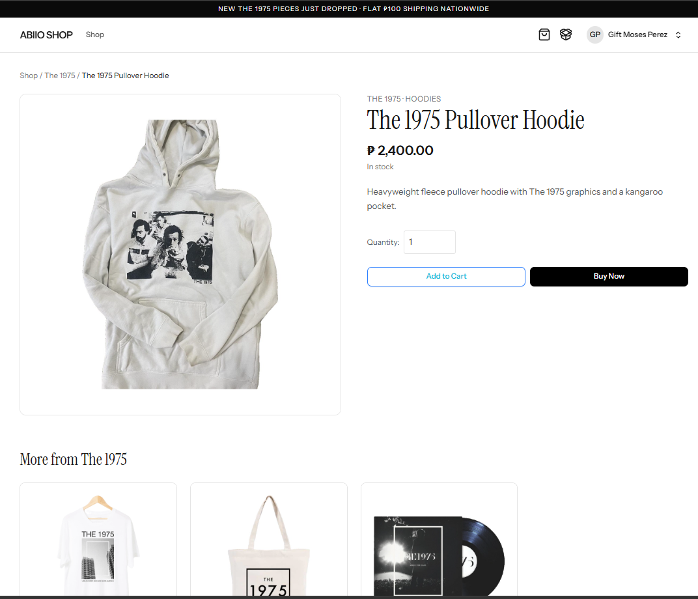
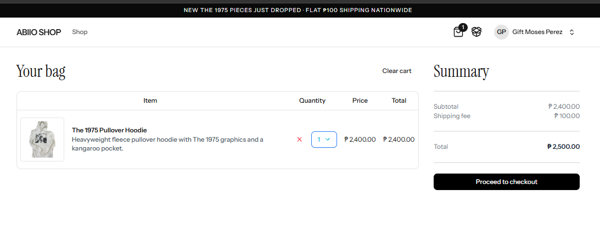
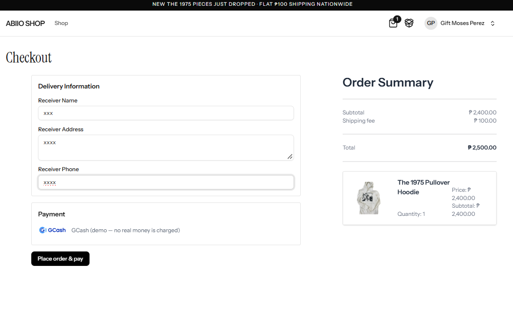
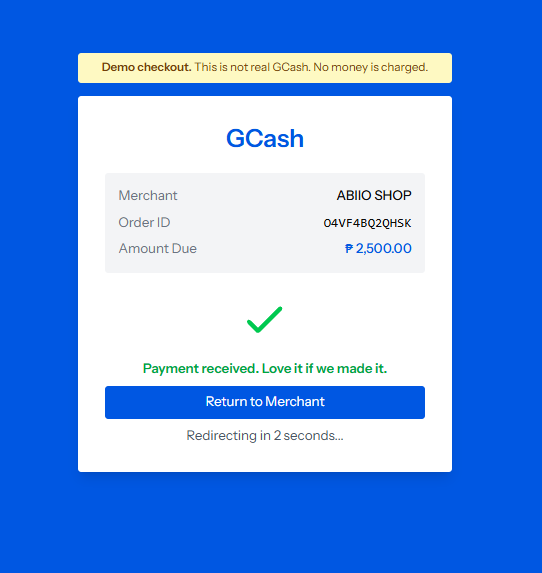
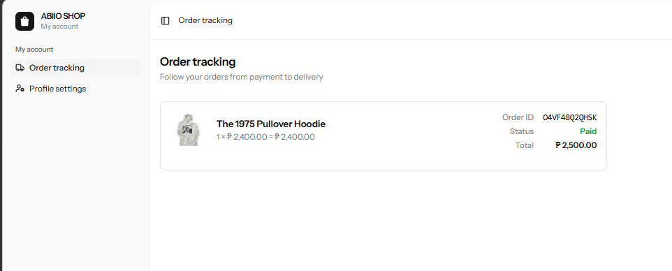
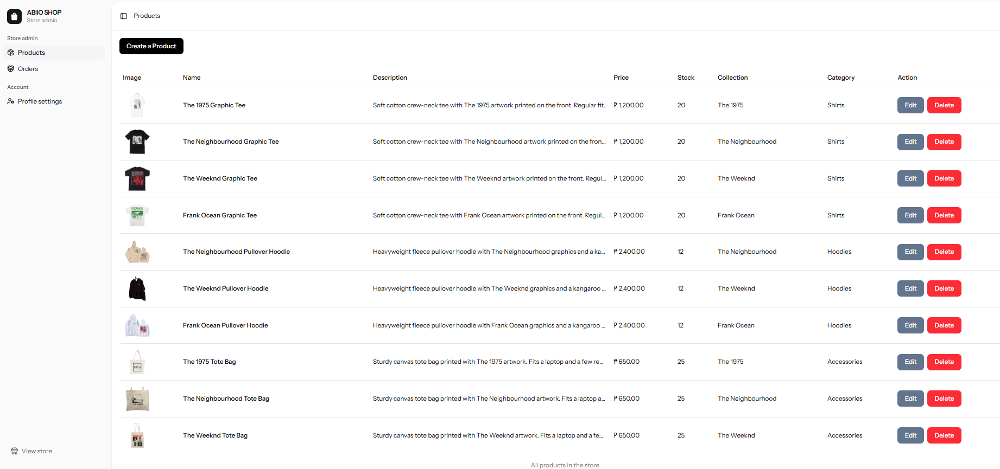
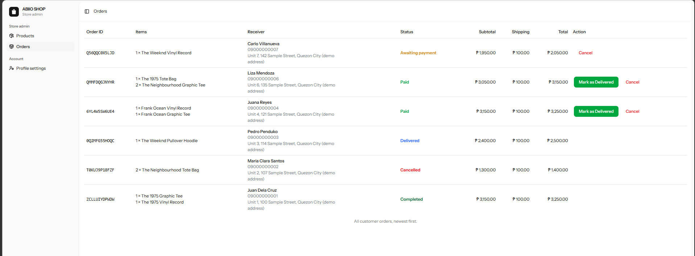

# ABIIO SHOP

**An unofficial band-merch store with The 1975 as the headline collection.** Customers browse, filter, add to cart, check out and pay with a simulated GCash flow, then track their orders. Admins manage products and fulfil orders.

**Live demo:** https://abiooshop.onrender.com
<sub>Hosted on a free tier, so the first load can take a few seconds. Payments are simulated; please don't enter real personal details.</sub>



---

## Highlights

- **Editorial storefront.** A monochrome, record-sleeve-inspired home page with a hero, a "Side A" tracklist for the headline band, "Side B" collection tiles and new arrivals.
- **Full shopping flow.** Shop filters by band and category, product pages with live stock, a cart, **Buy Now**, a validated checkout, a demo GCash payment (success, failure or cancel) and order tracking.
- **Order lifecycle.** Orders move `pending → paid → delivered → completed`. Customers or admins can cancel, and cancelling puts the stock back.
- **Admin dashboard.** Admins create, edit and delete products (with image upload and preview), mark orders delivered and cancel orders.
- **Consistent product photos.** Every photo is cut out and placed on a white square by a small local script ([`tools/product-photos/whiten.py`](tools/product-photos/whiten.py)).

## Screenshots

| Shop & filters | Product | Cart |
| --- | --- | --- |
|  |  |  |

| Checkout | Demo GCash payment | Order tracking |
| --- | --- | --- |
|  |  |  |

| Admin: products | Admin: orders |
| --- | --- |
|  |  |

## Tech stack

| Layer | Tools |
| --- | --- |
| Backend | Laravel 12 (PHP 8.4), Pest tests |
| Frontend | Inertia.js v2, React 19, TypeScript, Tailwind CSS 4, shadcn/ui components |
| Database | PostgreSQL on [Neon](https://neon.com) in production, SQLite locally |
| Hosting | Docker image on [Render](https://render.com), configured with a [`render.yaml`](render.yaml) Blueprint |

## Engineering notes

- **No overselling.** Checkout reserves stock inside a database transaction with row locks (`lockForUpdate`), so two shoppers can't buy the last item at the same time.
- **Prices come from the database.** Order totals are recalculated on the server from database prices, never from values sent by the browser.
- **One cart service.** [`CartService`](app/Services/CartService.php) handles guest carts (stored in the session) and account carts (stored in the database) through the same code. Logging in shows the account's own saved cart; registering keeps the guest's picks. Buy Now takes the purchased item out of the cart.
- **Access control.** Admin is a role that can't be set through any form. Admin routes sit behind middleware, and customers can only see and act on their own orders. Guests and customers don't receive admin route names in the page either.
- **Production hardening.** HTTPS only, with proxy trust, secure cookies and HSTS, plus security headers. Debug mode is off, all secrets come from environment variables, login is rate-limited, and `composer audit` and `npm audit` report no known vulnerabilities as of the last update.
- **Tests.** 41 Pest tests cover the shop, cart, checkout, payment, cancellation, admin actions, authentication and the product seeder. The app was also verified against PostgreSQL in the production Docker image before deploying.

## Run it locally

**Requirements:** PHP 8.2–8.4 and Composer (or [Laravel Herd](https://herd.laravel.com)), plus Node.js 22.

```bash
git clone https://github.com/gift-perez/abiooshop.git
cd abiooshop
composer install
npm ci
cp .env.example .env
php artisan key:generate
touch database/database.sqlite        # Windows: type nul > database\database.sqlite
php artisan migrate --seed            # prints a generated admin password if ADMIN_PASSWORD is empty
composer run dev                      # http://localhost:8000
```

- **Admin login.** Set `ADMIN_EMAIL` and `ADMIN_PASSWORD` in `.env` before seeding, or rerun `php artisan db:seed --class=UserSeeder` afterwards.
- **Tests.** Run `php artisan test`.

## Deploying

The production setup is free: a Render web service built from the [`Dockerfile`](Dockerfile), plus a Neon Postgres database. On startup the container caches config, runs migrations and seeds the admin account and the demo catalogue. Seeding is safe to repeat. See **[DEPLOY.md](DEPLOY.md)** for the step-by-step guide and the security checklist.

## Product photos

Photos live in `public/images/products/{band}/{band}_{category}.jpg`. The seeder attaches them automatically, and the white-background script keeps the originals outside the public folder. See [`public/images/products/README.md`](public/images/products/README.md).

## Project structure (main parts)

```
app/Services/CartService.php       cart logic for guests and accounts
app/Http/Controllers/              shop, cart, orders, admin products
database/seeders/                  admin account + demo catalogue
resources/js/pages/                Inertia pages (storefront, account, admin)
resources/js/layouts/              storefront and account layouts
docker/, Dockerfile, render.yaml   production image and Render Blueprint
tools/product-photos/whiten.py     background-removal script for product photos
```

## Disclaimer & credits

**ABIIO SHOP** is a portfolio project and an **unofficial fan store**. It isn't affiliated with The 1975, Dirty Hit, or any artist or label shown. Band names are used for identification only, and product images belong to their respective owners. No real payments are processed.

The project builds on the [Laravel React starter kit](https://github.com/laravel/react-starter-kit).
